# Mini ERP (Full JavaScript)

[](https://github.com/kucingops/erp-full-js/actions/workflows/ci.yml)

Mini ERP untuk UMKM distribusi: **master data → purchase order → stok masuk → sales order → stok keluar → dashboard**, lengkap dengan login dan hak akses per role.
Monorepo full TypeScript: backend **NestJS 12 + Prisma 7 + PostgreSQL 17**, frontend **Next.js 16 + TanStack + shadcn/ui**.

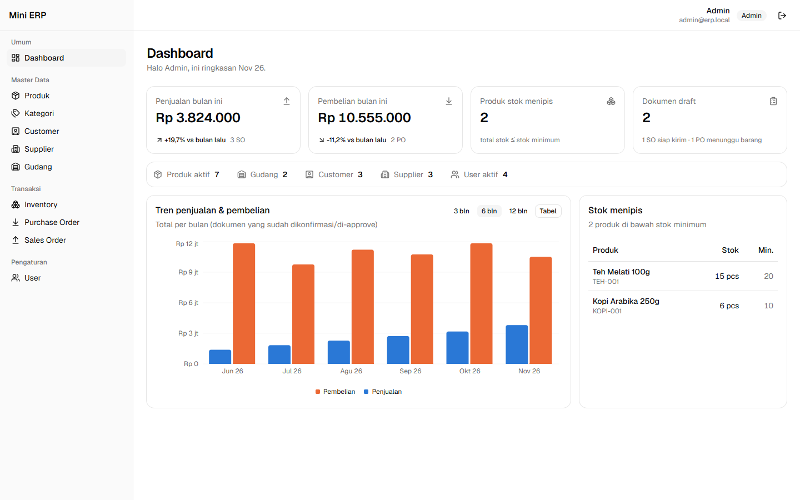

## Fitur

| Modul | Yang bisa dilakukan |
| --- | --- |
| **Auth & RBAC** | Login JWT (access token pendek + refresh token dengan rotation), 4 role (Admin, Gudang, Sales, Purchasing). Menu, halaman, dan endpoint disaring per role. |
| **Master data** | CRUD produk, kategori, customer, supplier, gudang. Search, sort, paginasi server-side. Data yang sudah dipakai transaksi tidak bisa dihapus (pakai nonaktif). |
| **Inventory** | Saldo stok per produk per gudang, kartu stok (riwayat mutasi append-only), penyesuaian stok manual, penanda stok menipis. |
| **Purchase order** | Draft → approve (Purchasing) → terima barang (Gudang) → stok bertambah otomatis. Bisa dibatalkan sebelum diterima. |
| **Sales order** | Draft → confirm (Sales, cek stok cukup) → kirim (Gudang) → stok berkurang otomatis. |
| **Dashboard** | KPI penjualan/pembelian bulan ini vs bulan lalu, tren 3/6/12 bulan (chart atau tabel), daftar stok menipis. Isinya menyesuaikan role. |
| **User** | Kelola akun dan role (khusus Admin). |

Semua perubahan stok lewat satu `InventoryService` di dalam transaksi database, jadi saldo stok dan kartu stok selalu sinkron.

## Arsitektur

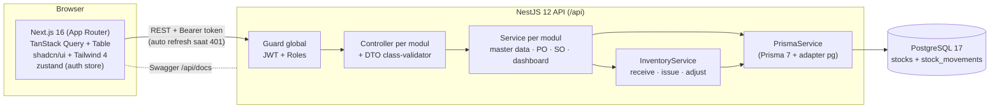

Alur stok:

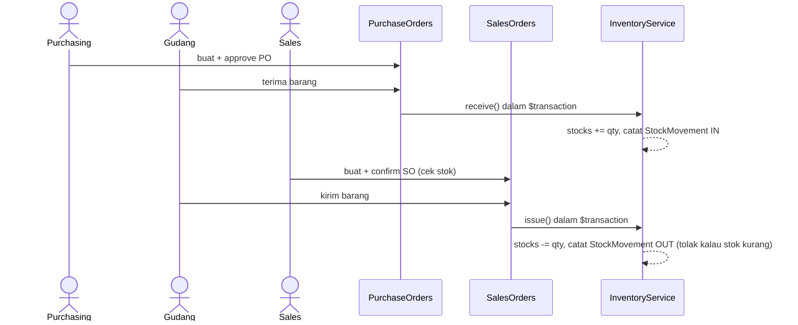

Keputusan desain (kenapa begini, alternatifnya apa) dicatat di [docs/decisions.md](docs/decisions.md). Detail per modul: [inventory](docs/inventory.md), [purchase order](docs/purchase-order.md), [sales order](docs/sales-order.md).

## Tech stack

| Layer | Stack |
| --- | --- |
| Backend | NestJS 12 (ESM), Prisma 7 (driver adapter `pg`, schema multi-file per domain), PostgreSQL 17, JWT (access + refresh rotation), class-validator, Swagger, Vitest |
| Frontend | Next.js 16 (App Router, cache components), React 19, TanStack Query 5, TanStack Table 9, shadcn/ui (Base UI) + Tailwind 4, Recharts, react-hook-form + zod, zustand |
| Tooling | Bun (package manager), Node LTS via mise, oxlint, ESLint, Docker Compose, GitHub Actions |

## Screenshot

| | |
| --- | --- |
| 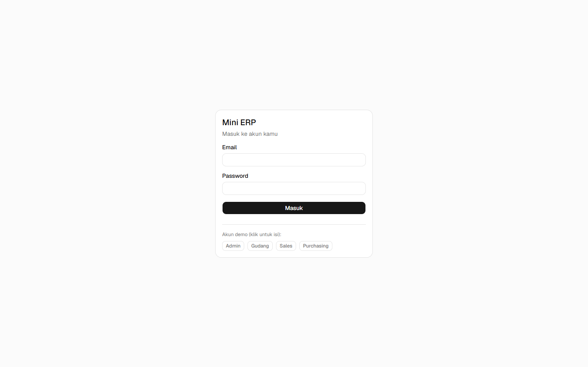 Login | 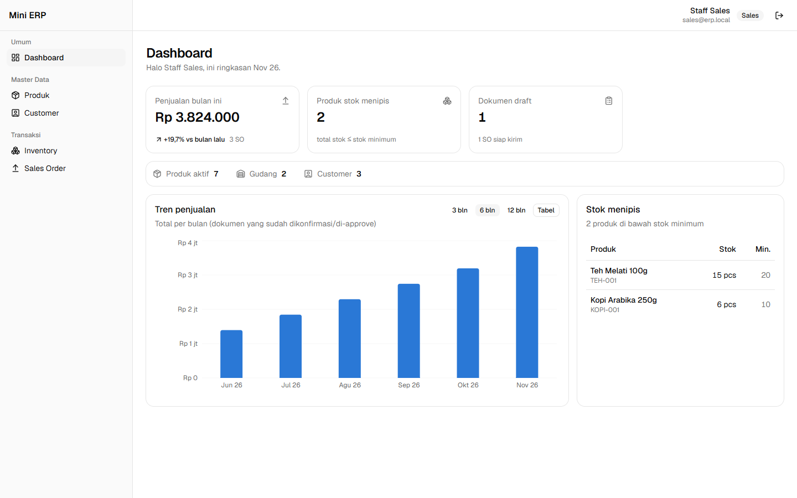 Dashboard untuk role Sales (hanya data penjualan) |
| 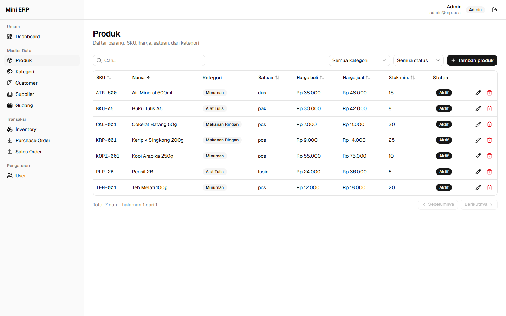 Produk | 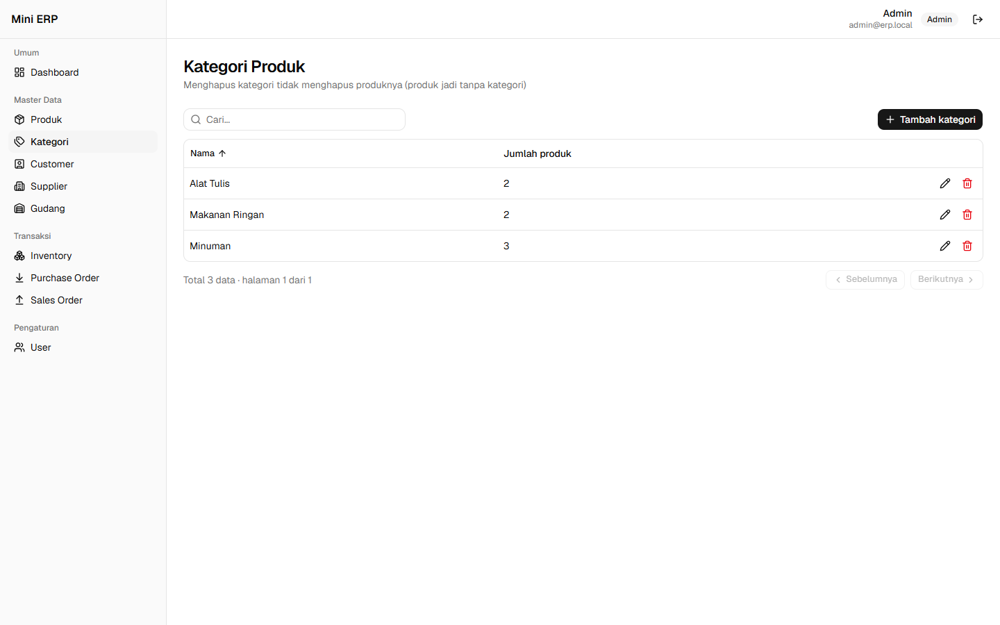 Kategori |
| 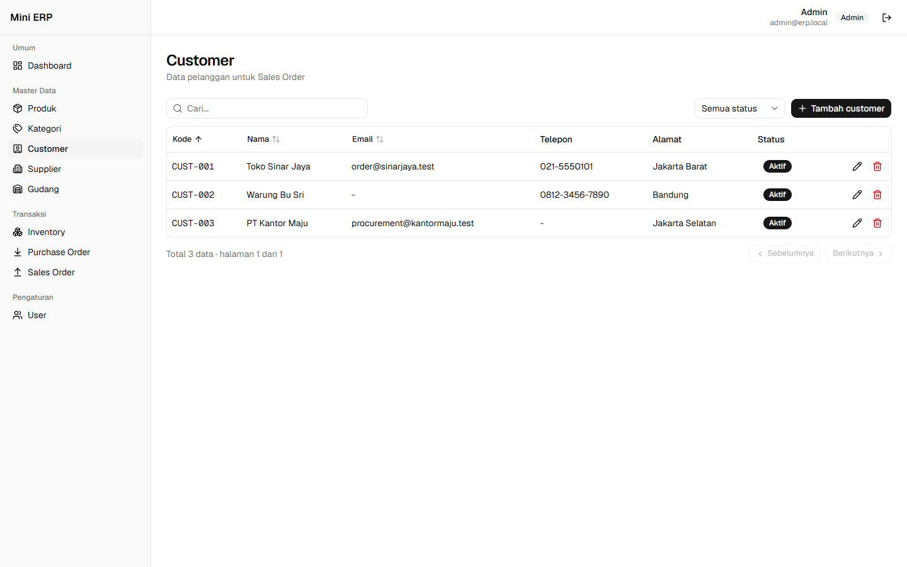 Customer | 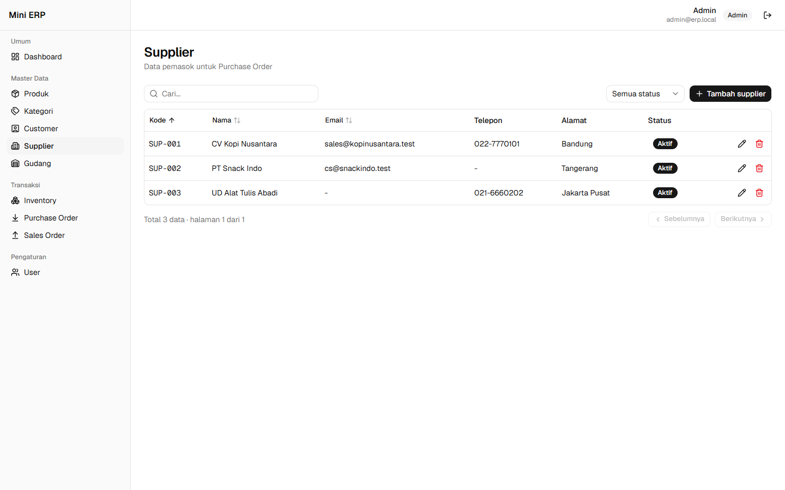 Supplier |
| 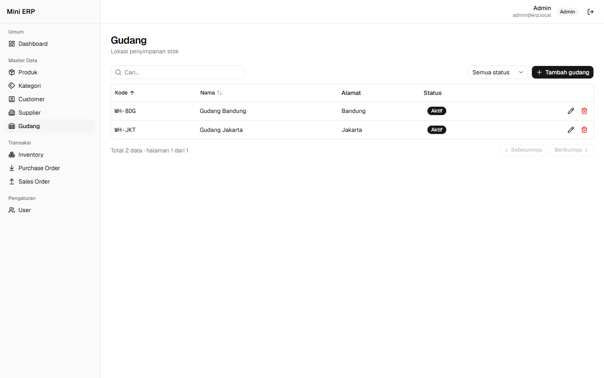 Gudang | 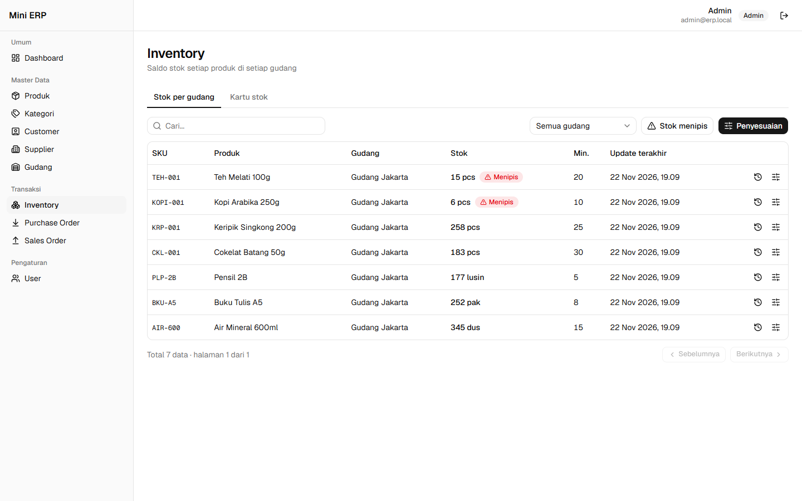 Stok per gudang |
| 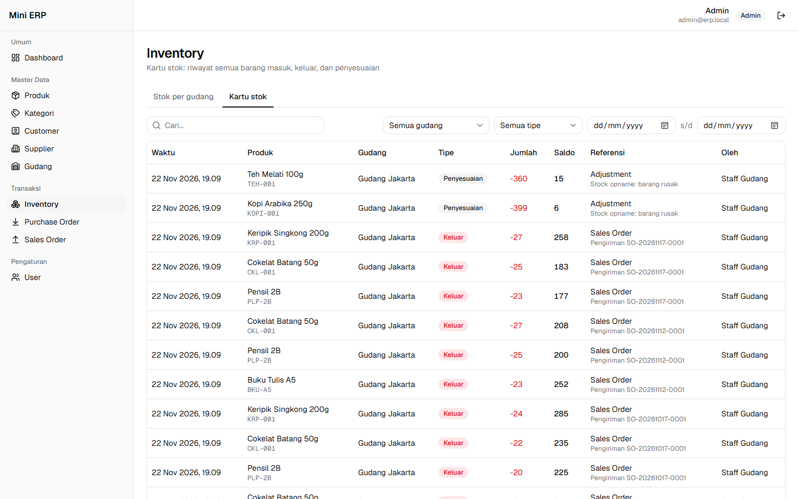 Kartu stok | 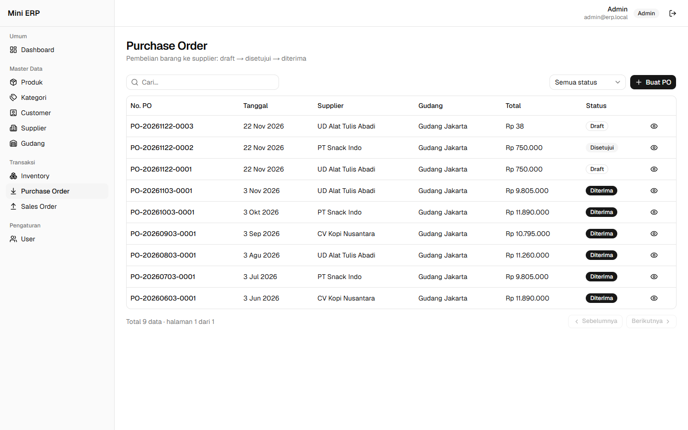 Daftar purchase order |
| 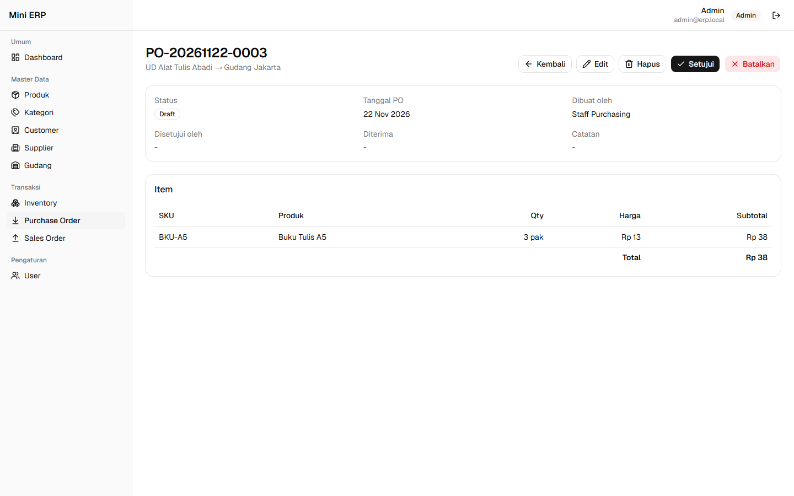 Detail PO (siap diterima) | 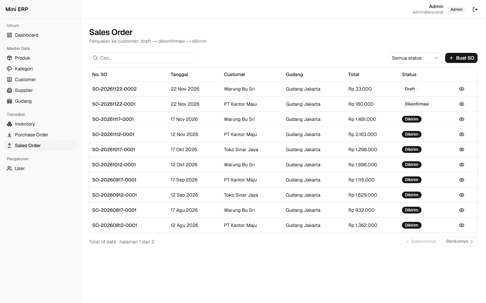 Daftar sales order |
|  Detail SO | 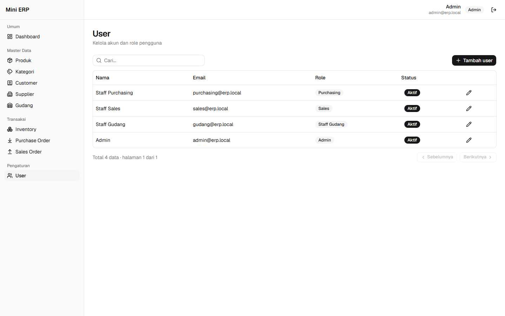 Manajemen user |

## Cara menjalankan

### Opsi A: Docker Compose (paling cepat)

Butuh Docker atau Podman. Migrasi dan seed akun demo jalan otomatis saat backend start.

```powershell
docker compose up --build
# atau: podman compose up --build
```

- Frontend: http://localhost:3000
- API + Swagger: http://localhost:3001/api/docs
- Postgres di host: `localhost:5433` (user/password `erp`/`erp`), port bisa diganti lewat env `POSTGRES_HOST_PORT`

### Opsi B: Lokal (tanpa Docker)

Prasyarat: [mise](https://mise.jdx.dev) (otomatis pasang Node LTS + Bun dari `mise.toml`), PostgreSQL 17.

```powershell
# 1. Buat database (sekali saja)
psql -U postgres -c "CREATE DATABASE erp_db;"

# 2. Backend
cd backend
bun install
copy .env.example .env      # isi password postgres + JWT_ACCESS_SECRET
bun run db:deploy           # migrasi
bun run db:seed             # akun demo + master data contoh
bun run start:dev           # http://localhost:3001/api/docs

# 3. Frontend (terminal lain)
cd frontend
bun install
copy .env.example .env.local
bun run dev                 # http://localhost:3000
```

## Akun demo

| Role | Email | Password | Bisa apa |
| --- | --- | --- | --- |
| Admin | admin@erp.local | Admin123! | Semua menu, termasuk kelola user |
| Staff Gudang | gudang@erp.local | Gudang123! | Kategori, gudang, stok + penyesuaian, terima PO, kirim SO |
| Sales | sales@erp.local | Sales123! | Customer, sales order (buat + confirm), lihat stok |
| Purchasing | purchasing@erp.local | Purchasing123! | Supplier, purchase order (buat + approve), lihat stok |

Matriks lengkap ada di [CONTRIBUTING.md](CONTRIBUTING.md#auth--rbac).

## Test & CI

```powershell
cd backend
bun run test        # unit test (Prisma di-mock, tanpa database)
bun run test:e2e    # e2e HTTP dengan supertest
bun run lint        # oxlint

cd ../frontend
bun run lint
bun run build       # termasuk type-check
```

GitHub Actions ([ci.yml](.github/workflows/ci.yml)) menjalankan di setiap PR: lint + unit + e2e + build backend, migrasi + seed (2x, cek idempotent) ke Postgres 17 sungguhan, lint + build frontend, dan build image Docker.

## Struktur

```
erp-full-js/
├── backend/          NestJS API
│   ├── prisma/
│   │   ├── schema/       schema per domain (auth, master-data, inventory, purchasing, sales)
│   │   ├── migrations/   migrasi SQL
│   │   └── seed/         seed data demo, satu file per modul
│   └── src/
│       ├── common/       guard, decorator, DTO pagination, filter error Prisma
│       ├── auth/ users/  login, refresh, logout, me; CRUD user
│       ├── master-data/  products, categories, customers, suppliers, warehouses
│       ├── inventory/    InventoryService + endpoint stok/kartu stok/adjustment
│       ├── purchase-orders/ sales-orders/ dashboard/
├── frontend/         Next.js
│   └── src/
│       ├── app/(dashboard)/  semua halaman yang butuh login
│       ├── components/       ui/ (shadcn), data-table/, layout/
│       ├── features/<modul>/ hooks API + form per modul
│       └── lib/              api client, auth store, navigasi + RBAC menu
├── docker-compose.yml
├── .github/workflows/ci.yml
├── CONTRIBUTING.md   konvensi kode
└── docs/             keputusan desain + catatan per modul + screenshot
```

## Status

- [x] Fondasi: monorepo, auth + RBAC, layout dashboard, manajemen user
- [x] Master data
- [x] Inventory
- [x] Purchase order
- [x] Sales order
- [x] Dashboard
- [x] Docker Compose + CI
- [ ] Invoicing, laporan, multi-currency (sedang dikerjakan)
